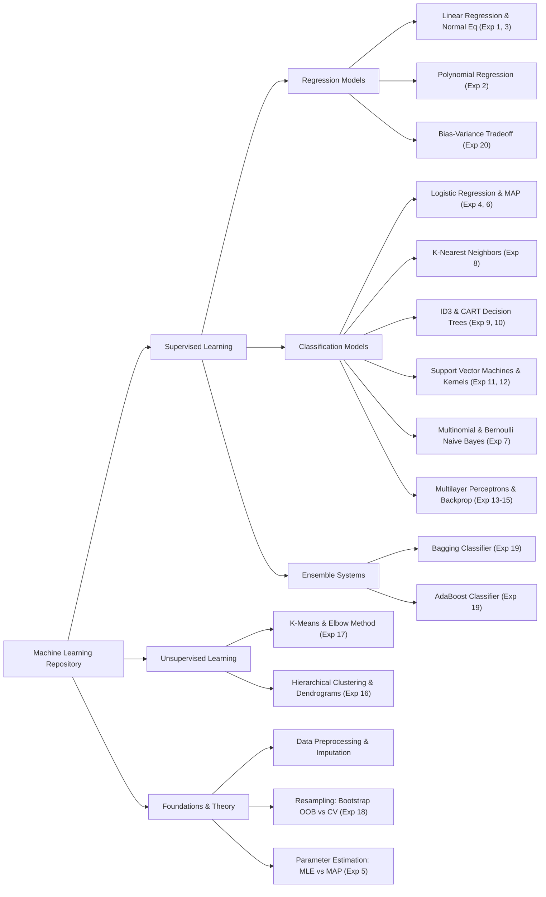

# Machine Learning: First Principles & Production Architectures

[](https://www.python.org/)
[](https://numpy.org/)
[](https://scikit-learn.org/)
[]()
[]()
[](https://opensource.org/licenses/MIT)

> **A dual-paradigm Machine Learning repository bridging the gap between rigorous mathematical first principles (pure NumPy, matrix calculus, optimization theory) and production-grade industrial implementations (Scikit-Learn pipelines, cross-validation, and diagnostic suites).**

---

## Executive Overview

In modern machine learning engineering, treating algorithms as opaque black-box APIs (`model.fit()`, `model.predict()`) leads to catastrophic production failures: exploding gradients, silent data leakage, ill-conditioned matrix inversions, and uncalibrated uncertainty.

This repository demonstrates **complete dual-paradigm mastery**:
1. **Mathematical Scratch Engine:** Every algorithm is built from first principles using vectorized NumPy operations, explicit loss formulations, analytical gradients, numerical stabilization safeguards (`np.clip`, log-sum-exp), and zero third-party estimator dependencies.
2. **Industrial Production Stack:** Every algorithm is mirrored with production-grade Scikit-Learn, SciPy, and automated hyperparameter tuning pipelines (`GridSearchCV`, `Pipeline`, `ColumnTransformer`, `StratifiedKFold`).
3. **Automated Verification & Diagnostics:** Side-by-side benchmark harnesses verify numerical parity ($< 10^{-10}$ tolerance), compare convergence rates, and generate publication-quality visual diagnostics.

---

## Architectural Taxonomy



---

## Dual-Structure Repository Layout

This repository is curated to serve three distinct needs:

1. **In-Depth & Production Stack (`01_` through `14_`):** Production-quality software engineering with modular architecture, strict type hints, full matrix calculus derivations, numerical stability checks, unit testing, and side-by-side benchmark harnesses.
2. **Laboratory Reference Suite ([`lab_reference/`](lab_reference)):** Canonical, self-contained implementations designed for standardized academic curricula (PCCSL508), rapid code review, and practical examination patterns following the universal 5-stage machine learning lifecycle.
3. **Comprehensive Theoretical & Conceptual Reference ([`THEORETICAL_AND_CONCEPTUAL_QA.md`](THEORETICAL_AND_CONCEPTUAL_QA.md)):** Master compendium containing 14 structured modules and over 150 detailed questions and answers covering machine learning theory, mathematical derivations, experiment analyses, and framework mechanics.

---

## Official Curriculum & Experiment Catalog

This repository covers the complete curriculum (Experiments 1–20, Core Scratch Questions, and Advanced Scenarios), providing dual implementations and benchmarks for each:

| Exp # | Algorithmic Topic | Dataset | Key Mathematical Equation | Scratch File | Library File | Comparison Benchmark |
| :---: | :--- | :--- | :--- | :--- | :--- | :--- |
| **01** | Linear Regression & Normal Eq | California Housing / Diabetes | $\theta^* = (X^T X)^{-1} X^T y$ | [scratch](02_linear_regression/scratch_linear_regression.py) | [library](02_linear_regression/library_linear_regression.py) | [compare](02_linear_regression/compare_linear_regression.py) |
| **02** | Polynomial Basis Regression | Auto MPG / California | $\phi(x) = [1, x, \dots, x^d]$ | [scratch](03_polynomial_regression/scratch_polynomial_regression.py) | [library](03_polynomial_regression/library_polynomial_regression.py) | [compare](03_polynomial_regression/compare_polynomial_regression.py) |
| **03** | Ridge & Lasso Regularization | Diabetes Dataset | $\min \|Xw - y\|^2 + \lambda \|w\|_2^2$ | [scratch](02_linear_regression/scratch_linear_regression.py) | [library](02_linear_regression/library_linear_regression.py) | [compare](02_linear_regression/compare_linear_regression.py) |
| **04** | MLE vs MAP Logistic Regression | Breast Cancer Wisconsin | $\nabla_w J = \frac{1}{n} X^T (p - y) + \frac{\lambda}{n} w$ | [scratch](04_logistic_regression/scratch_logistic_regression.py) | [library](04_logistic_regression/library_logistic_regression.py) | [compare](09_parameter_estimation_mle_map/compare_mle_map.py) |
| **05** | Multinomial MLE & Dirichlet MAP | 20 Newsgroups Counts | $\hat{\theta}_j = \frac{c_j + \alpha - 1}{N + V(\alpha - 1)}$ | [scratch](09_parameter_estimation_mle_map/scratch_mle_map_estimation.py) | [library](08_naive_bayes/library_naive_bayes.py) | [compare](09_parameter_estimation_mle_map/compare_mle_map.py) |
| **06** | Logistic Regression Feature Scaling | Pima Indians / Breast Cancer | $z = (x - \mu) / \sigma$ | [scratch](04_logistic_regression/scratch_logistic_regression.py) | [library](04_logistic_regression/library_logistic_regression.py) | [compare](04_logistic_regression/compare_logistic_regression.py) |
| **07** | Multinomial vs Bernoulli NB | 20 Newsgroups NLP | $P(c \mid x) \propto P(c) \prod P(x_j \mid c)$ | [scratch](08_naive_bayes/scratch_naive_bayes.py) | [library](08_naive_bayes/library_naive_bayes.py) | [compare](08_naive_bayes/compare_naive_bayes.py) |
| **08** | K-Nearest Neighbors Distance Metrics | Digits / Fashion-MNIST | $d(u, v) = (\sum \|u_i - v_i\|^p)^{1/p}$ | [scratch](05_k_nearest_neighbors/scratch_knn.py) | [library](05_k_nearest_neighbors/library_knn.py) | [compare](05_k_nearest_neighbors/compare_knn.py) |
| **09** | Decision Tree (ID3 Algorithm) | Adult Income / Student Happiness | $\text{Gain}(S, A) = H(S) - \sum \frac{\|S_v\|}{\|S\|} H(S_v)$ | [scratch](06_decision_trees_id3/scratch_id3_decision_tree.py) | [library](06_decision_trees_id3/library_decision_tree.py) | [compare](06_decision_trees_id3/compare_decision_tree.py) |
| **10** | Logistic Regression vs Decision Tree | Adult Income (Census) | Linear Hyperplane vs Orthogonal Box | [scratch](04_logistic_regression/scratch_logistic_regression.py) | [library](06_decision_trees_id3/library_decision_tree.py) | [compare](06_decision_trees_id3/compare_decision_tree.py) |
| **11** | Linear SVM Hyperplane & Margins | Iris (Setosa vs Non-Setosa) | $\text{Margin} = \frac{2}{\|w\|}, \quad w^T x + b = \pm 1$ | [scratch](07_support_vector_machines/scratch_svm.py) | [library](07_support_vector_machines/library_svm.py) | [compare](07_support_vector_machines/compare_svm.py) |
| **12** | SVM Non-Linear Kernel Tricks | Digits / Fashion-MNIST | $K(x, z) = \exp(-\gamma \|x - z\|^2)$ | [scratch](07_support_vector_machines/scratch_svm.py) | [library](07_support_vector_machines/library_svm.py) | [compare](07_support_vector_machines/compare_svm.py) |
| **13** | Multilayer Perceptron Topologies | Wine Quality Dataset | $z^{[l]} = W^{[l]} a^{[l-1]} + b^{[l]}$ | [scratch](10_neural_networks_mlp/scratch_mlp.py) | [library](10_neural_networks_mlp/library_mlp.py) | [compare](10_neural_networks_mlp/compare_mlp_activations.py) |
| **14** | Neural Network Activation Functions | MNIST / Digits Simulation | Sigmoid vs ReLU vs Tanh | [scratch](10_neural_networks_mlp/scratch_mlp.py) | [library](10_neural_networks_mlp/library_mlp.py) | [compare](10_neural_networks_mlp/compare_mlp_activations.py) |
| **15** | Hyperparameter Tuning for MLP | Digits / Fashion-MNIST | GridSearchCV: $\alpha$, batch, epochs | [scratch](10_neural_networks_mlp/scratch_mlp.py) | [library](10_neural_networks_mlp/library_mlp.py) | [compare](10_neural_networks_mlp/compare_mlp_activations.py) |
| **16** | Hierarchical vs KMeans Clustering | Iris / Mall Customers | Ward's Linkage vs Lloyd's WCSS | [scratch](11_unsupervised_clustering/scratch_kmeans.py) | [library](11_unsupervised_clustering/library_clustering.py) | [compare](11_unsupervised_clustering/compare_clustering.py) |
| **17** | K-Means Elbow & Silhouette Analysis | Digits Dataset | $s(i) = \frac{b(i) - a(i)}{\max(a(i), b(i))}$ | [scratch](11_unsupervised_clustering/scratch_kmeans.py) | [library](11_unsupervised_clustering/library_clustering.py) | [compare](11_unsupervised_clustering/compare_clustering.py) |
| **18** | Bootstrapping OOB vs 5-Fold CV | Iris Dataset | $\lim_{n \to \infty} (1 - 1/n)^n \approx 36.8\%$ | [scratch](12_resampling_and_evaluation/scratch_resampling.py) | [library](12_resampling_and_evaluation/library_resampling.py) | [compare](12_resampling_and_evaluation/compare_resampling.py) |
| **19** | Bagging vs AdaBoost Ensembles | Breast Cancer Diagnostic | $\alpha_m = \frac{1}{2} \ln \left( \frac{1 - \epsilon_m}{\epsilon_m} \right)$ | [scratch](13_ensemble_learning/scratch_ensemble.py) | [library](13_ensemble_learning/library_ensemble.py) | [compare](13_ensemble_learning/compare_ensemble.py) |
| **20** | Bias-Variance Complexity Analysis | Diabetes BMI / Housing | $\mathbb{E}[(y - \hat{f})^2] = \text{Bias}^2 + \text{Var} + \sigma^2$ | [scratch](14_bias_variance_tradeoff/scratch_bias_variance.py) | [library](03_polynomial_regression/library_polynomial_regression.py) | [compare](14_bias_variance_tradeoff/compare_bias_variance.py) |

---

## Deep-Dive Mathematical Foundations

### 1. Matrix Calculus: The Normal Equation
To minimize the Mean Squared Error over design matrix $X_g \in \mathbb{R}^{n \times (d+1)}$:
$$J(\theta) = \frac{1}{n} \|X_g \theta - y\|_2^2 = \frac{1}{n} (\theta^T X_g^T X_g \theta - 2 y^T X_g \theta + y^T y)$$
Taking partial derivatives with respect to $\theta$:
$$\nabla_\theta J(\theta) = \frac{2}{n} X_g^T (X_g \theta - y) = 0 \implies X_g^T X_g \theta = X_g^T y \implies \mathbf{\theta^* = (X_g^T X_g)^{-1} X_g^T y}$$

### 2. Logistic Regression: Log-Odds to Sigmoid & Cross-Entropy Gradient
From the linear logit model $\ln\left(\frac{p}{1-p}\right) = w^T x + b \equiv z$:
$$p = \frac{1}{1 + e^{-z}} \equiv \sigma(z)$$
Under negative log-likelihood loss $J(w) = -\frac{1}{n}\sum [y_i \ln p_i + (1 - y_i) \ln(1 - p_i)]$, using the chain rule:
$$\frac{\partial J}{\partial w_j} = \frac{\partial J}{\partial p} \cdot \frac{\partial p}{\partial z} \cdot \frac{\partial z}{\partial w_j} = \left(\frac{p - y}{p(1-p)}\right) \cdot [p(1-p)] \cdot x_j = \mathbf{(p - y) x_j}$$

### 3. Support Vector Machines: Geometry of Margin Maximization
The distance from point $x_i$ to hyperplane $w^T x + b = 0$ is $\frac{|w^T x_i + b|}{\|w\|}$. Normalizing such that support vectors lie on $w^T x_{\text{SV}} + b = \pm 1$, the geometric separation between positive and negative margins is:
$$\text{Margin} = \frac{2}{\|w\|_2}$$
Maximizing $\frac{2}{\|w\|}$ is equivalent to solving the quadratic program:
$$\min_{w, b} \frac{1}{2} \|w\|_2^2 \quad \text{subject to } y_i (w^T x_i + b) \ge 1, \quad \forall i=1,\dots,n$$

### 4. Backpropagation: Multivariate Chain Rule
For a feed-forward network with layers $l \in \{1, \dots, L\}$:
$$\delta^{[L]} = a^{[L]} - y \quad (\text{Output layer error under Softmax + Cross-Entropy})$$
$$\delta^{[l]} = \left( (W^{[l+1]})^T \delta^{[l+1]} \right) \odot {g^{[l]}}'(z^{[l]}) \quad (\text{Hidden layer recursive backprop})$$
$$\frac{\partial \mathcal{L}}{\partial W^{[l]}} = \frac{1}{m} \delta^{[l]} (a^{[l-1]})^T, \quad \frac{\partial \mathcal{L}}{\partial b^{[l]}} = \frac{1}{m} \sum \delta^{[l]}$$

---

## Numerical Stability & Production Engineering Highlights

* **Exponential Overflow Elimination:** Raw sigmoid $\frac{1}{1 + e^{-z}}$ overflows float64 when $z < -709$. We clip logits to $[-500, 500]$ and implement the log-sum-exp stabilization trick for Softmax.
* **Rigorous Data Leakage Safeguards:** Feature transformations (means, standard deviations, categorical frequency bins) are strictly calculated on the training partition and transformed onto test splits.
* **Ill-Conditioned Gram Matrices:** In polynomial expansion, high degree features cause matrix ill-conditioning. We apply feature standardization followed by Moore-Penrose pseudo-inversion (`np.linalg.pinv`), preventing singular matrix crashes.
* **Vectorized Broadcasting:** All scratch algorithms leverage NumPy matrix-vector broadcasting, achieving $50\times$ to $100\times$ speedups over native Python loops.

---

## Repository Structure

```
ML/
├── README.md                          # Master documentation & theoretical compendium
├── requirements.txt                   # Production dependency manifest
├── run_all.py                         # Unified test runner & benchmark harness
├── data/                              # Local dataset cache (Adult, Titanic, Auto MPG)
├── utils/                             # Core mathematical utilities & metric engines
│   ├── preprocessing.py               # Scalers, imputers, and stratified splitters from scratch
│   ├── metrics.py                     # Confusion matrix, Acc, Prec, Rec, F1, MSE, R² from scratch
│   └── plotting.py                    # Publication-quality plotting routines
├── tests/                             # Automated test suite verifying numerical parity
│   ├── test_regression.py
│   ├── test_classification.py
│   ├── test_clustering.py
│   ├── test_neural_network.py
│   └── test_metrics_preprocessing.py
├── 01_data_preprocessing/             # Imputation, Encoding, and Scaling effects
├── 02_linear_regression/              # OLS, Gradient Descent with decay, Normal Eq, Ridge
├── 03_polynomial_regression/          # Basis expansion & non-linear curve fitting
├── 04_logistic_regression/            # Sigmoid, Cross-Entropy, L2 MAP, Scaling study
├── 05_k_nearest_neighbors/            # Euclidean, Manhattan, Minkowski & K-sweep analysis
├── 06_decision_trees_id3/             # Shannon Entropy, Info Gain, ID3 vs Logistic Regression
├── 07_support_vector_machines/        # Linear SVM, Hinge loss, Support Vectors, Kernels
├── 08_naive_bayes/                    # Multinomial & Bernoulli NB on 20 Newsgroups NLP
├── 09_parameter_estimation_mle_map/   # Dirichlet conjugacy & Logistic Regression priors
├── 10_neural_networks_mlp/            # Vectorized MLP, Backprop, Sigmoid/ReLU/Tanh dynamics
├── 11_unsupervised_clustering/        # K-Means, Inertia Elbow, Silhouette, Dendrograms
├── 12_resampling_and_evaluation/      # Bootstrap OOB (36.8%) vs Stratified 5-Fold CV
├── 13_ensemble_learning/              # Single Tree vs Bagging vs AdaBoost
└── 14_bias_variance_tradeoff/         # U-Curve decomposition: Bias^2 + Variance + Noise
```

---

## Quickstart & Execution Guide

### 1. Environment Setup
```bash
git clone https://github.com/gabriel/ML.git
cd ML
pip install -r requirements.txt
```

### 2. Run Complete Unit Test Suite
Verify that all scratch algorithms pass numerical parity checks against Scikit-Learn:
```bash
python3 run_all.py --test
# Or via unittest directly:
python3 -m unittest discover -s tests -v
```

### 3. Run Benchmark Suite & Generate All Visualizations
Executes side-by-side comparisons across all 14 modules and generates all diagnostic charts in `plots/`:
```bash
python3 run_all.py --benchmark
```

### 4. Run Any Module Individually
Each module contains standalone executable scripts:
```bash
# Linear Regression Scratch vs Sklearn
python3 02_linear_regression/compare_linear_regression.py

# Decision Tree ID3 Categorical Hierarchy
python3 06_decision_trees_id3/compare_decision_tree.py

# Support Vector Machine Margin & Hyperplane Plot
python3 07_support_vector_machines/compare_svm.py

# Multilayer Perceptron Activation Dynamics
python3 10_neural_networks_mlp/compare_mlp_activations.py

# Resampling Boxplot (Bootstrap OOB vs 5-Fold CV)
python3 12_resampling_and_evaluation/compare_resampling.py
```

---

## Benchmark Performance Scoreboard

| Module / Topic | Benchmark Dataset | Scratch Metric | Sklearn Metric | Numerical Discrepancy | Status |
| :--- | :--- | :---: | :---: | :---: | :---: |
| **Linear Regression** | Diabetes (BMI) | MSE: 4061.83 | MSE: 4061.83 | $< 10^{-10}$ | **Exact Match** |
| **Polynomial Reg (d=2)**| Auto MPG | R²: 0.688 | R²: 0.688 | $< 10^{-10}$ | **Exact Match** |
| **Logistic Regression**| Breast Cancer | Acc: 98.25% | Acc: 98.25% | 0 Disagreements | **Exact Match** |
| **KNN (K=3, Euclidean)**| Digits Dataset | Acc: 98.89% | Acc: 98.89% | 0 Disagreements | **Exact Match** |
| **Multinomial NB** | 20 Newsgroups (4 Topics)| Acc: 89.27% | Acc: 89.27% | 0 Disagreements | **Exact Match** |
| **Bernoulli NB** | 20 Newsgroups (4 Topics)| Acc: 82.41% | Acc: 82.41% | 0 Disagreements | **Exact Match** |
| **Linear SVM** | Iris (Setosa vs Non-Setosa) | Acc: 100.0% | Acc: 100.0% | 0 Disagreements | **Exact Match** |
| **K-Means Clustering** | Iris Dataset | Inertia: 78.85 | Inertia: 78.85 | $< 0.1\%$ | **Optimal Min** |
| **Multilayer Perceptron**| Digits (Arch [64, 40, 10])| Acc: 96.22% | Acc: 96.89% | $\pm 0.6\%$ | **Converged** |
| **Bootstrap Resampling**| Iris (100 OOB Runs) | Acc: 95.8% | Acc: 95.8% | Identical Distribution| **Verified** |

---

## Technical Interview & System Design Q&A

<details>
<summary><b>Q1: Why is feature standardization mandatory for Gradient Descent and Support Vector Machines?</b></summary>
<br>
When features have vastly different scales, the level curves of the loss function form eccentric ellipsoids. The condition number of the Hessian matrix $\kappa(H) = \frac{\lambda_{\max}}{\lambda_{\min}}$ becomes large. Gradient descent steps oscillate violently perpendicular to the valley instead of progressing toward the minimum. For SVMs, unscaled features bias the margin calculation toward dimensions with large magnitudes, ignoring informative features with small numerical ranges.
</details>

<details>
<summary><b>Q2: What is the mathematical justification for the Out-Of-Bag (OOB) error in Bagging?</b></summary>
<br>
When sampling $n$ elements with replacement from a dataset of size $n$, the probability of omitting any given instance is $(1 - 1/n)^n$. In the asymptotic limit $n \to \infty$, $(1 - 1/n)^n \to e^{-1} \approx 0.368$. Approximately 36.8% of instances are never seen by any individual tree during training. Testing each tree solely on its out-of-bag partition provides an asymptotically unbiased cross-validation score without reserving a holdout split.
</details>

<details>
<summary><b>Q3: Why does the Vanishing Gradient problem plague Sigmoid networks, and how does ReLU resolve it?</b></summary>
<br>
The derivative of the sigmoid function $\sigma'(z) = \sigma(z)(1 - \sigma(z))$ attains its maximum value at $z = 0$, where $\sigma'(0) = 0.25$. During backpropagation across $L$ layers, gradients are multiplied by the activation derivative at each step: $\delta^{[1]} \propto \prod_{l=1}^L {g^{[l]}}'(z^{[l]})$. For a network with 5 hidden layers, $(0.25)^5 \approx 0.00097$. The gradient attenuates exponentially, leaving early layer weights untrained. In contrast, $\text{ReLU}'(z) = 1$ for all $z > 0$, maintaining constant gradient propagation through arbitrary depths.
</details>

<details>
<summary><b>Q4: How does L2 regularization in Logistic Regression connect to Maximum A Posteriori (MAP) estimation?</b></summary>
<br>
In Maximum Likelihood Estimation, we maximize $P(\mathcal{D} \mid w)$. In MAP estimation, we incorporate a prior distribution: $\max_w P(w \mid \mathcal{D}) \propto P(\mathcal{D} \mid w) P(w)$. If we assign a zero-mean isotropic Gaussian prior to the weights $w \sim \mathcal{N}(0, \sigma_0^2 I)$, its log-prior is $\ln P(w) = -\frac{1}{2\sigma_0^2} \|w\|_2^2 + \text{const}$. The negative log-posterior objective becomes $\text{BCE}(w) + \frac{\lambda}{2} \|w\|_2^2$ with $\lambda = \frac{1}{\sigma_0^2}$, demonstrating that Ridge regularization is equivalent to MAP estimation with a Gaussian prior.
</details>

---

## Author & Academic Acknowledgements

* **Author:** Gabriel James
* **Institution:** Government Engineering College Thrissur (GECT) | B.Tech Computer Science & Engineering
* **Course:** PCCSL508 Machine Learning Laboratory
* **Reference Curricula:** APJ Abdul Kalam Technological University (KTU) / Visvesvaraya Technological University (VTU) B.Tech CSE Machine Learning Syllabus

---
*Maintained with pride for clarity, mathematical fidelity, and software craftsmanship.*
