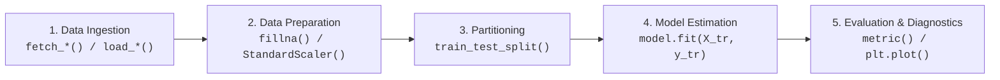

# Machine Learning Laboratory Reference Suite

[](https://www.python.org/)
[]()
[]()
[](https://opensource.org/licenses/MIT)

> **Canonical, self-contained reference implementations designed for academic rigor, rapid code review, and standardized practical examination patterns (KTU / VTU / GECT B.Tech CSE Machine Learning Laboratory).**

---

## Architectural Principles: The 5-Stage Machine Learning Lifecycle

Every script in this reference suite adheres to a standardized, deterministic 5-stage lifecycle that eliminates common pitfalls (such as training data leakage and unhandled missingness):



1. **Deterministic Data Ingestion:** Standard datasets loaded cleanly without unverified external dependencies.
2. **Leakage-Free Transformation:** Transformers and scalers compute statistical aggregates ($\mu_{\text{train}}, \sigma_{\text{train}}$) strictly on the training partition and are mapped onto validation/testing partitions.
3. **Stratified Partitioning:** Preserves target label proportions across training and evaluation splits.
4. **Estimation & Inference:** Dual pathways: vectorized mathematical closed-forms / subgradient descent from first principles, and optimized Scikit-Learn estimators.
5. **Multi-Metric Diagnostics:** Evaluation goes beyond raw accuracy to include precision, recall, F1, confusion matrices, and publication-ready visual diagnostics.

---

## Reference Suite File Index

### 1. Core Mathematical Scratch Implementations (Pure NumPy)

| Program File | Topic & Dataset | Algorithmic Formulations |
| :--- | :--- | :--- |
| [`scratch_linear_regression_gd.py`](scratch_linear_regression_gd.py) | **Linear Regression (Diabetes BMI)** | Bias prepending: $X_g = [\mathbf{1}, X]$<br>Hyperbolic LR schedule: $\alpha_t = \frac{\alpha_0}{1 + kt}$<br>Analytical normal equation: $\theta^* = (X_g^T X_g)^{-1} X_g^T y$ |
| [`scratch_knn_digits_imputation.py`](scratch_knn_digits_imputation.py) | **KNN with Imputation (Digits)** | Missingness insertion & univariate column imputation<br>Permutation partition from scratch<br>Euclidean ($L_2$) & Manhattan ($L_1$) distance voting |
| [`scratch_logistic_regression_l2.py`](scratch_logistic_regression_l2.py) | **Logistic Regression (Breast Cancer)** | Numerically stable sigmoid: $\text{clip}(z, -500, 500)$<br>Gradient descent with $L_2$ Ridge penalty (Gaussian prior)<br>Confusion matrix metrics: TP, TN, FP, FN, Precision, Recall, F1 |
| [`scratch_id3_decision_tree.py`](scratch_id3_decision_tree.py) | **ID3 Decision Tree (Happiness)** | Shannon Entropy: $H(S) = -\sum p \log_2(p)$<br>Information Gain: $\text{Gain}(S, A) = H(S) - \sum \frac{\|S_v\|}{\|S\|} H(S_v)$<br>Recursive nested dictionary tree induction |

---

### 2. Standard Syllabus Experiments (Canonical Scikit-Learn Implementations)

| Exp # | Script Link | Algorithmic Task & Dataset |
| :---: | :--- | :--- |
| **01** | [`exp01_linear_regression.py`](exp01_linear_regression.py) | Single-variable Linear Regression: GD vs. Normal Equation vs. Scikit-Learn |
| **02** | [`exp02_polynomial_regression.py`](exp02_polynomial_regression.py) | Polynomial Regression: Degrees 1, 2, and 3 comparison on California Housing |
| **03** | [`exp03_ridge_lasso.py`](exp03_ridge_lasso.py) | Ridge ($L_2$) and Lasso ($L_1$) feature shrinkage with cross-validated alpha |
| **04** | [`exp04_logistic_regression_mle_map.py`](exp04_logistic_regression_mle_map.py) | Logistic Regression: MLE ($C=\infty$) vs. Gaussian MAP ($L_2$) vs. Laplace MAP ($L_1$) |
| **05** | [`exp05_mle_vs_map_multinomial.py`](exp05_mle_vs_map_multinomial.py) | Multinomial text counts: MLE vs. Dirichlet Conjugate Prior ($\alpha=2$) |
| **06** | [`exp06_logistic_regression_scaling.py`](exp06_logistic_regression_scaling.py) | Empirical impact of feature standardization on Logistic Regression convergence |
| **07** | [`exp07_naive_bayes_text.py`](exp07_naive_bayes_text.py) | Text classification with Multinomial NB vs. Bernoulli NB on 20 Newsgroups |
| **08** | [`exp08_knn_image_classification.py`](exp08_knn_image_classification.py) | Digit image classification with K-Nearest Neighbors across $K \in [1, 3, 5, 7, 9]$ |
| **09** | [`exp09_decision_tree_entropy.py`](exp09_decision_tree_entropy.py) | Decision tree classifier induction using Shannon Entropy and Information Gain |
| **10** | [`exp10_logistic_vs_decision_tree.py`](exp10_logistic_vs_decision_tree.py) | Architectural comparison: Linear hyperplanes vs. Axis-aligned orthogonal splits |
| **11** | [`exp11_linear_svm_iris.py`](exp11_linear_svm_iris.py) | Linear SVM with Decision Boundary Display & support vector identification |
| **12** | [`exp12_svm_kernels.py`](exp12_svm_kernels.py) | Non-linear classification via Linear, Polynomial ($d=3$), and RBF kernels |
| **13** | [`exp13_mlp_architectures.py`](exp13_mlp_architectures.py) | Multilayer Perceptron with hidden layer variations on Wine Quality |
| **14** | [`exp14_neural_network_activations.py`](exp14_neural_network_activations.py) | Activation dynamics: Sigmoid (`logistic`), Tanh, and ReLU training velocity |
| **15** | [`exp15_hyperparameter_tuning_mlp.py`](exp15_hyperparameter_tuning_mlp.py) | Exhaustive grid search over learning rates, batch sizes, and training epochs |
| **16** | [`exp16_hierarchical_vs_kmeans.py`](exp16_hierarchical_vs_kmeans.py) | Hierarchical Dendrogram (Ward Linkage) vs. Lloyd's K-Means clustering |
| **17** | [`exp17_kmeans_elbow_digits.py`](exp17_kmeans_elbow_digits.py) | K-Means on Digits: Optimal cluster cardinality selection via the Elbow Method |
| **18** | [`exp18_bootstrap_cross_val.py`](exp18_bootstrap_cross_val.py) | Resampling: 100 Out-of-Bag (OOB) Bootstrap rounds vs. 5-Fold Cross-Validation |
| **19** | [`exp19_bagging_boosting.py`](exp19_bagging_boosting.py) | Ensemble learning: Single Tree vs. BaggingClassifier vs. AdaBoostClassifier |
| **20** | [`exp20_bias_variance_tradeoff.py`](exp20_bias_variance_tradeoff.py) | Bias-Variance Tradeoff analysis across polynomial degrees 1 to 10 |

* **[`preprocessing_toolkit.py`](preprocessing_toolkit.py)**: Foundational reference routine for missing value handling, label encoding, and scaling.

---

## Technical Theory & Conceptual Quick Reference

> For the comprehensive 14-module question and answer reference covering all theoretical foundations, mathematical derivations, and experiment-specific analyses, see [**`THEORETICAL_AND_CONCEPTUAL_QA.md`**](../THEORETICAL_AND_CONCEPTUAL_QA.md).

1. **Why do we append a column of ones to feature matrices?**
   It allows the bias/intercept $b$ to be integrated into parameter vector $\theta = [b, w_1, \dots, w_d]^T$, permitting the model equation to be computed as a single inner product $\hat{y} = X_g \theta$.
2. **What is the mathematical distinction between Ridge ($L_2$) and Lasso ($L_1$)?**
   Ridge adds penalty $\lambda \|w\|_2^2$, shrinking coefficients continuously toward zero without eliminating them. Lasso adds penalty $\lambda \|w\|_1$, whose diamond-shaped constraint geometry produces exact zeros ($w_j = 0$), performing automated feature selection.
3. **Why must feature scaling be learned strictly from training data?**
   Computing scalers over the entire dataset introduces **data leakage**, allowing global mean $\mu$ and standard deviation $\sigma$ from the test set to inform model training, creating overly optimistic performance estimates.
4. **Why does Bootstrapping exhibit an ~36.8% Out-of-Bag (OOB) rate?**
   Sampling $n$ instances with replacement from a set of size $n$, the probability that an individual instance is never drawn is $(1 - 1/n)^n$. As $n \to \infty$, $\lim (1 - 1/n)^n = e^{-1} \approx 0.368$.
5. **How does $L_2$ regularization connect to Bayesian MAP estimation?**
   Ridge regression is mathematically equivalent to Maximum A Posteriori (MAP) estimation under a zero-mean Gaussian prior $w \sim \mathcal{N}(0, \sigma_0^2 I)$, where $\lambda = \frac{1}{\sigma_0^2}$.

---

## Execution Guide

All reference scripts run standalone out-of-the-box:

```bash
cd lab_reference

# Execute any reference program:
python3 scratch_linear_regression_gd.py
python3 scratch_knn_digits_imputation.py
python3 exp01_linear_regression.py
python3 exp11_linear_svm_iris.py
python3 exp18_bootstrap_cross_val.py
```
